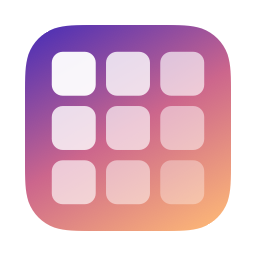
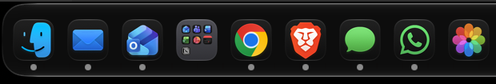
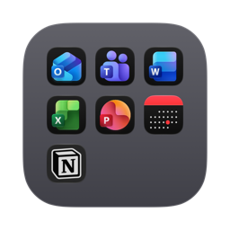
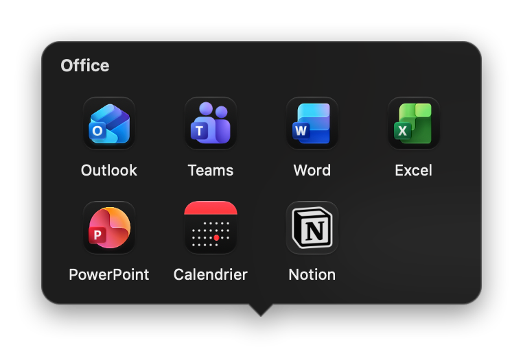
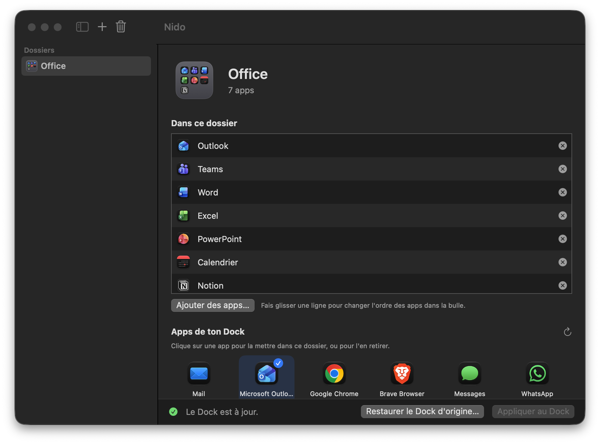

<p align="center">
  
</p>

<h1 align="center">Nido</h1>

<p align="center">
  <b>Des dossiers façon iPhone pour le Dock du Mac.</b><br>
  Une app macOS gratuite et open source qui range plusieurs apps du Dock derrière une seule icône, au milieu des autres apps, comme les dossiers de l'écran d'accueil de l'iPhone.
</p>

<p align="center">
  macOS 14+ · Swift / SwiftUI · aucune dépendance · aucune requête réseau
</p>

---

## Le principe

Le Dock se remplit vite : on garde des dizaines d'apps sous la main sans vouloir les en retirer. Nido les regroupe dans des **dossiers** :

- chaque dossier occupe **une seule place dans le Dock**, au milieu des apps (pas seulement à droite comme les piles de macOS) ;
- son icône montre les apps qu'il contient en **grille 3×3**, comme sur l'iPhone ;
- un clic ouvre une **bulle** au-dessus de l'icône avec les apps du dossier ; un clic sur une app la lance.

<p align="center">
  
</p>

| L'icône du dossier | La bulle, au clic |
|:---:|:---:|
|  |  |

## L'app de gestion

On crée et on modifie les dossiers dans la fenêtre de Nido, puis on clique sur « Appliquer au Dock ».

<p align="center">
  
</p>

## Fonctionnalités

**Dossiers**
- Autant de dossiers que vous voulez, avec le nom de votre choix.
- Ajout d'apps par glisser-déposer depuis le Finder, avec « Ajouter des apps… », ou d'un clic sur les apps de votre Dock.
- Ordre des apps réglable par glisser-déposer : c'est l'ordre de la grille et de la bulle.
- L'icône du dossier montre les 9 premières apps ; la bulle les montre toutes (5 par ligne au maximum, en lignes équilibrées).

**Dans le Dock**
- « Appliquer au Dock » place chaque dossier à la place de sa première app et retire du Dock les apps qu'il contient.
- Un dossier déjà présent garde sa place, même renommé.
- Supprimer un dossier, ou en retirer une app, remet les apps dans le Dock, là où était le dossier.
- Avant la première modification, Nido sauvegarde votre Dock ; « Restaurer le Dock d'origine… » le remet exactement comme avant.

**La bulle**
- S'ouvre au-dessus de l'icône cliquée, et s'adapte à un Dock à gauche ou à droite, à l'agrandissement et au masquage automatique.
- Se ferme d'un clic à côté, avec Échap, ou d'un nouveau clic sur le dossier.
- Si vous la refermez sans rien lancer, le focus revient à l'app où vous étiez.

## Installation

Nido n'est pas distribué en binaire signé : on le compile soi-même (2 minutes).

**Prérequis** : macOS 14 ou plus récent, Xcode ou les Command Line Tools (Swift 5.10+).

```bash
git clone https://github.com/flynnslegacy/nido.git
cd nido
scripts/build-app.sh            # crée build/Nido.app
scripts/build-app.sh --install  # ou : copie dans /Applications et lance l'app
```

Aucune autorisation n'est demandée : Nido ne lit que la liste des apps du Dock et les icônes des apps.

**Tests** :

```bash
swift test
```

**Désinstaller** : cliquez sur « Restaurer le Dock d'origine… », quittez Nido, puis supprimez `/Applications/Nido.app` et `~/Library/Application Support/Nido`.

## Fonctionnement

### Architecture

```
src/
├── NidoCore/        Logique pure, sans dépendance système (testée)
│   ├── Models        Dossiers, apps, noms de fichiers sûrs, emplacements
│   ├── DockTiles     Modifications de la liste des apps du Dock
│   ├── BubbleLayout  Grille, position de la bulle, forme avec sa flèche, géométrie de l'icône
│   └── FolderStore   Enregistrement des dossiers (JSON)
├── Nido/            L'app de gestion
│   ├── App/          Point d'entrée, menus, modèle de la fenêtre
│   ├── Services/     Dock, construction des dossiers, dessin des icônes
│   └── Views/        Fenêtre SwiftUI
└── NidoFolder/      Le lanceur copié dans chaque dossier (la bulle)
tests/
├── NidoCoreTests    Tests de la logique pure
└── NidoTests        Tests de « Appliquer au Dock » avec un faux Dock
```

### Comment un dossier tient dans le Dock

Le Dock n'accepte que des apps dans sa partie gauche. Chaque dossier est donc une **petite app générée** :

1. Nido copie son modèle de lanceur (`NidoFolder.app`) dans `~/Library/Application Support/Nido/Folders/<identifiant>/<Nom>.app`.
2. Il lui donne un identifiant propre (`local.nido.folder.<uuid>`), le nom du dossier, la liste des apps (`folder.json`) et une icône dessinée pour l'occasion (`.icns`).
3. Il signe à nouveau le paquet (signature locale « ad hoc ») et l'enregistre auprès de LaunchServices.
4. Il réécrit la liste `persistent-apps` des préférences du Dock (`com.apple.dock`) puis relance le Dock, qui ne relit ses préférences qu'au démarrage.

Le lanceur est une app « agent » (`LSUIElement`) : il n'a pas de point « app ouverte » sous son icône et n'ajoute aucune icône au Dock. Au lancement, ou quand on reclique sur son icône (événement de réouverture), il affiche la bulle.

### La bulle

- C'est un `NSPanel` sans bordure, non activant, avec un fond `NSVisualEffectView` découpé à la forme de la bulle et de sa flèche.
- Sa position vient de l'endroit du clic et des réglages du Dock : orientation, taille des icônes, agrandissement, masquage automatique.
- Un moniteur global de clics la referme quand on clique ailleurs ; il n'a besoin d'aucune autorisation.

### Notes techniques

- **macOS 26 et plus récent** : une icône d'app translucide ou qui ne remplit pas la forme standard est réduite dans un cadre gris par le Dock. Les icônes de dossier ont donc un fond opaque, aux coins continus de la grille d'icônes d'Apple.
- Les mini-icônes suivent le style d'icônes choisi dans Réglages Système (par exemple sombre). L'icône d'un dossier est une image fixe : après un changement d'apparence ou d'icône d'une app, cliquez de nouveau sur « Appliquer au Dock ».
- Une app lancée depuis un dossier apparaît dans le Dock tant qu'elle est ouverte : c'est le fonctionnement normal de macOS pour les apps qui ne sont pas épinglées.

## Confidentialité

- Aucune analyse, aucun pistage, aucune requête réseau.
- Nido ne lit et ne modifie que les préférences du Dock.
- Les dossiers et la sauvegarde du Dock restent dans `~/Library/Application Support/Nido`, sur votre Mac.

## Licence

[MIT](LICENSE)
